# Claude Code Dashboard 使い方ガイド

Claude Code と Claude Desktop の利用状況を、自分の PC の中だけで1つの画面に集めて見るためのアプリの説明書です。
はじめて使う人と、毎日使う人の両方に向けて、起動から各ページの見方、利用上限・送信上限、整理ページの使い方、安全の設計、困ったときの対処までをまとめました。

- 画面の画像は、すべて架空の合成データで撮ったものです。実際のセッション名やパスは写っていません。
- ボタンや見出しなど画面に出る文字は「」で囲んで書きます。
- 手順は、操作と、その結果として期待すること（→ の行）の組で書きます。書いたとおりにならないときは、[8. 困ったとき](#8-困ったとき) を見てください。
- アプリの中にも短い説明（サイドバー下の「使い方ガイド」）があります。用語の意味はそちらが詳しく、このガイドは起動・安全・困ったときを受け持ちます。

## 目次

1. [このアプリでできること](#1-このアプリでできること)
2. [用意するもの](#2-用意するもの)
3. [起動する](#3-起動する)
4. [各ページの見方](#4-各ページの見方)
5. [利用上限と送信上限](#5-利用上限と送信上限)
6. [整理ページの使い方](#6-整理ページの使い方)
7. [安全の設計と、自分で確かめる方法](#7-安全の設計と自分で確かめる方法)
8. [困ったとき](#8-困ったとき)
9. [付録](#9-付録)

---

## 1. このアプリでできること

| 知りたいこと・やりたいこと | 使うページ |
|---|---|
| 対応を待っているもの・送信上限で止まっているもの・利用上限の使いすぎを、開いてすぐに | ホーム |
| 指揮役のセッションから各セッションへの指示と、各セッションからの報告の流れ | ホーム（組織図） |
| Claude Desktop のセッションのうち、どれが動いていて、どれが止まって返事を待っているか | セッション一覧 |
| 5時間・週の利用上限をどれだけ使ったか、誰が使っているか | 利用上限 |
| 対応を待っているセッション、返事の来ていない指示、再開すると高くつくセッション | 整理 |
| 全グループ共通の決まりと、グループごとの指揮役の決まり（忘れたときに読み返す） | 組織のルール |
| Claude Code のルール（CLAUDE.md）・スキル・設定を、退避つきで編集する | プロジェクトの概要・ルール管理・スキル管理・設定 |
| 過去の作業の振り返り（実行ログ・セッションの診断・タスク・メモリ） | 実行ログ・セッション監視・タスク履歴・メモリ管理 |
| ルールとスキルを別の PC に持ち出す・取り込む | 移行 |
| 同じ家の Wi-Fi のスマホから、セッションの様子を読み取り専用で見る | スマホから見る |

このアプリは、外部と通信せず、AI（LLM）も呼びません。費用はかかりません。Claude Desktop のデータは読むだけで、書き換えません（[7章](#7-安全の設計と自分で確かめる方法)）。

---

## 2. 用意するもの

| 起動のしかた | 向いている人 | 必要なもの |
|---|---|---|
| 配布 exe（おすすめ） | はじめて使う人・ふだん使う人 | Windows 11（64ビット）。Node.js は要りません |
| ブラウザ（開発用） | 中身を確かめたい人・開発する人 | Windows 11、Node.js と npm、このリポジトリのファイル。Node.js 25.3.0・npm 11.6.2 で動作を確かめました |

Claude Desktop のセッションを見るページ（ホームと、Claude Desktop の3ページ）は、同じ PC で Claude Desktop（Microsoft Store 版で確認）を使っていれば、データの場所を自動で探して表示します。

---

## 3. 起動する

### 3-1. 配布 exe で起動する

1. 配布された `ClaudeCodeDashboard-<版>-portable.exe`（v0.3.0 なら `ClaudeCodeDashboard-0.3.0-portable.exe`）を、好きなフォルダに置いてダブルクリックする
   → 初回だけ、Windows の警告（SmartScreen）が出ることがあります。コード署名をしていないためです。
2. 警告が出たら『詳細情報』を押し、『実行』を押す（Windows の画面の文字は『』で書きます）
   → 進み具合と残り時間の目安を表示する小さな画面が出ます。起動には20〜25秒ほどかかります（exe が自分を一時フォルダへ展開する時間がほとんどで、この間は進み具合が動かないことがあります）。
   → 遅い PC では、起動のたびに、窓が出るまで30秒以上かかることがあります。何度も開かず、待ってください。展開の間は、同じ案内の文の画像だけが出ます。
   → 遅い PC で、前回の起動の3倍（最低60秒）を過ぎても準備が終わらないときは、終了せずに「まだ準備中です」と出ます。［待つ］を押すと待ち続け、［やめる］を押すと起動をやめます。小さな画面が出てから20秒を過ぎると、その前でも小さな［やめる］が出ます。秒は「この画面が出てから〇秒」の1か所に出ます。
3. 待つ
   → アプリのウィンドウが開き、「ホーム」が表示されます。Claude Desktop を使っていれば、上に件数（あなたの対応待ち・送信上限で停止・利用上限）、その下に組織図が出ます。
4. Claude Code の設定を見るために、プロジェクトを登録する。サイドバーの「プロジェクトの概要」を開くと、はじめての起動では「プロジェクトが未登録です」と出るので、右上の「+」（「プロジェクトを追加」）から、Claude Code の設定のあるフォルダ（たとえば `~/.claude` や、`CLAUDE.md` を置いたプロジェクトのフォルダ）を登録する
   → 「プロジェクト「…」を登録しました」と出て、プロジェクトの概要にルール数などが出ます。

覚えておくこと：

- アプリは、このPCの中だけ（`127.0.0.1`）で待ち受けます。ポートは 38417 を優先して使います。38417 がほかのアプリに使われているときだけ、空いているポートで起動し、画面の上部に「別のポートで起動しました」と出ます（[8章](#8-困ったとき)）。
- exe をもう一度ダブルクリックしても、2つ目は起動せず、開いているウィンドウが前に出ます。ただし、起動の間（約30秒。案内の画像や小さな画面が出ている間）は、開き直さないでください。開き直すと、2つ目も約30秒かけて準備をしてから終わるので、そのぶん起動が遅くなります。
- 登録したプロジェクトや設定は `%APPDATA%\claude-code-dashboard` に保存されます。exe を新しい版に置き換えても消えません。
- サンプルデータは exe に入っていません。試したいときは、リリースのページから `sample-data-v<版>.zip`（v0.3.0 なら `sample-data-v0.3.0.zip`）を取得して展開し、「プロジェクトの概要」の右上の「+」からそのフォルダを登録します。

### 3-2. ブラウザで起動する（開発用）

このリポジトリを取得した（`git clone` した）フォルダで、次の順に実行します。

1. 依存するパッケージを入れる

   ```bash
   npm install
   ```

   → 最後に `added … packages`（入れ直したときは `up to date`）のような行が出て終わります。

2. 開発サーバーを起動する

   ```bash
   npm run dev
   ```

   → `Local:` の行に `http://127.0.0.1:3000` が出て、続けて `Ready` が出ます。3000番をほかのアプリが使っているときは、止まらずに `Port 3000 is in use … using available port 3001 instead.` と出て、`Local:` の行が `http://127.0.0.1:3001` のような別のポートになります。

3. ブラウザで、`Local:` の行に出たアドレス（ふつうは `http://127.0.0.1:3000`）を開く
   → 左にサイドバー、右に「ホーム」が出ます。Claude Desktop を使っていれば、件数と組織図が出ます。Claude Desktop のデータも会話ログも無い PC では「セッションが見つかりません」と出ます（合成データで試すときは [3-3](#3-3-合成データで-claude-desktop-のページを試す)）。

4. サイドバーの「プロジェクトの概要」を開いて、数字を確かめる
   → 右上に「サンプルプロジェクト」が選ばれていて、リポジトリの `sample-data/` を対象に、「有効ルール数」が 2 / 3、「登録スキル数」が 2、「記録済みタスク数」が 4、「直近の 1-Shot 達成度」が 100点と出ます。

止めるときは、`npm run dev` を実行したターミナルで Ctrl + C を押します。

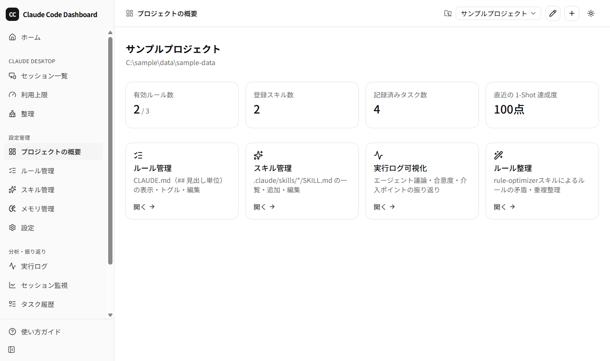

### 3-3. 合成データで Claude Desktop のページを試す

自分の Claude Desktop のデータを使わずに、架空のデータでホーム（件数と組織図）と「セッション一覧」「利用上限」「整理」を試せます（ブラウザで起動しているときの手順）。

1. 合成データを作る（出力先は空のフォルダ。例：`C:\ccd-sample`）

   ```bash
   node scripts/make-org-chart-sample.mjs C:/ccd-sample
   ```

   → 合成データを作りました、という行と、`config/desktop-sessions.json` に書く内容（`dataDir` と `projectsRoot`）、`config/usage.json` に書く内容（`snapshotsPath` と `projectsRoot`）が表示されます。

2. 表示された内容で、リポジトリの `config/desktop-sessions.json` と `config/usage.json` を作る（どちらも Git の管理対象外です）
   → `config/` にファイルができます。中身は、次の手順で起動し直したときに読み込まれます。
   スイッチ（`CCD_DESKTOP_AUTODETECT=0`）を付けて起動すると、この2つのファイルで指定した場所だけを読みます。ファイルを書き忘れても、この PC の本物の Claude Desktop のデータは読みません（「自動で探すのを止めています（CCD_DESKTOP_AUTODETECT=0）」と出て0件になります）。ふだん使うときは、スイッチを付けずに起動します。
3. 開発サーバーを起動し直す（`npm run dev` を Ctrl + C で止めて、本物のデータを自動で探さないスイッチを付けて、もう一度実行）

   ```bash
   $env:CCD_DESKTOP_AUTODETECT='0'; npm run dev
   ```

   → 「セッション一覧」に、試験グループ・別グループの合成のセッション（00_リーダー_試験、01_画面の修正 など）が出ます。「利用上限」には、5時間 22%・週 14% のゲージが出ます。

上限ガードの帯を試すときは、手順1を `node scripts/make-org-chart-sample.mjs --guard C:/ccd-sample` で実行し直して、開発サーバーを起動し直します（最後の5時間が92%になり、ホームと Claude Desktop の3ページの上部に「上限ガード中：新しい指示は保留中です」の帯が出ます）。

合成データは、作った時刻を基準に直近4時間の出来事を作ります。古くなったら作り直して、もう一度起動し直します。詳しくは `sample-data/claude-desktop/README.md` にあります。

---

## 4. 各ページの見方

### 共通の部分

- 左のサイドバーは、いちばん上の「ホーム」の下が、「Claude Desktop」「設定管理」「分析・振り返り」「ツール」に分かれています。下の「使い方ガイド」は、アプリの中の短い説明です。いちばん下のボタンでサイドバーを細く畳めます（「サイドバーを閉じる」。状態は次の起動でも保たれます）。
- 右上は、テーマ（「ライト」「ダーク」「システムに合わせる」）です。選んでいるプロジェクトを使うページ（設定管理の各ページ・実行ログ・タスク履歴・移行・ルール整理）だけ、その左に、対象のプロジェクトの切り替え、鉛筆（「プロジェクトを編集」）、「+」（「プロジェクトを追加」）が出ます。ホーム・Claude Desktop のページ・セッション監視・使い方ガイドには出ません。上のバーの幅が狭いとき（スマートフォンの幅や、サイドバーを開いた狭い窓）は、プロジェクトの切り替えが2段目に回ります。とても狭いときは、赤い「グローバル設定」の印がアイコンだけになります。
- 実際の `~/.claude` を選んでいるときは、「グローバル設定」の印と注意が出て、主な書き込みの前に確認が出ます。書き込みを試すときは「サンプルプロジェクト」に切り替えてください。
- プロジェクトの「登録を解除」は、アプリの登録だけを消します。実際のフォルダやファイルは消えません。

### ホーム

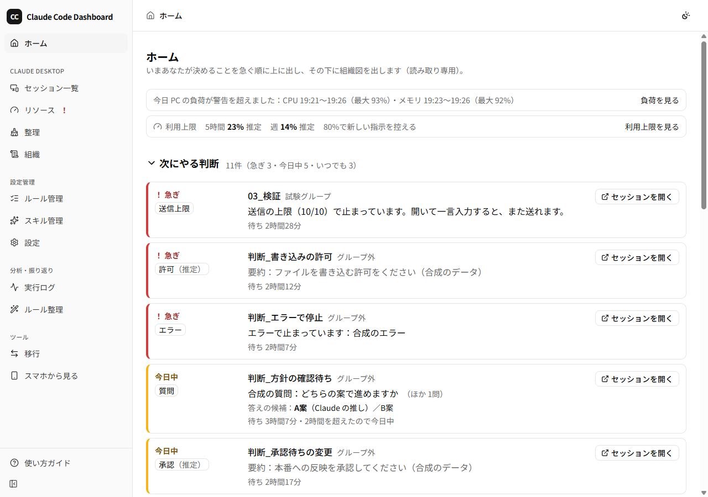

- 分かること：開いてすぐに、対応を待っているもの・止まっているもの・上限の使いすぎと、指揮役と各セッションの動きが分かります。選んでいるプロジェクトとは関係しません（右上にプロジェクトの切り替えは出ません）。
- 上の3つのカード：
  - 「あなたの対応待ち」：全グループの、あなたの対応を待っているセッションの件数です（許可待ち・承認待ち・判断待ち・送信上限で停止・エラー・届かなかった送信。待機は入りません）。整理ページの「あなたの対応待ち」と同じ数です。押すと整理ページへ移ります。
  - 「送信上限で停止」：送信上限で止まっているセッションの数です。1件以上のときは赤い枠で出ます。押すと整理ページへ移り、「セッションを開く」で対処できます。
  - 「利用上限」：5時間と週の%です。利用上限のページのゲージと同じ値で、「推定」か「公式値」かを添えます。80%で黄、90%で橙、95%で赤になります。押すと利用上限のページへ移ります。
  - 3つのカードは、組織図の読み込みを待たずに出ます。
- 読み込みに時間がかかるとき（遅い PC・データが大きいとき）：
  - 開いた直後から、見出しと、カード・組織図の枠（灰色）が出ます。件数と利用上限の公式値 → 利用上限の推定 → 組織図の順に、中身が出てきます。利用上限は、まず「公式値」が出て、推定が来ると「推定」の値に入れ替わります。
  - 1.5秒以上待つと、上のバーに段階の印（✓ 件数・… 利用上限・… 組織図。✓ は済み、… は読み込み中、！ は読み込めなかった）と、待った秒が出ます。印を押すと、その欄へ移ります。全部そろうと消えます。
  - 30秒たっても答えが来ない欄には「時間がかかっています（30秒以上）。このまま待てます。」と［もう一度読み込む］が出ます。待っていれば、答えが来た時点で中身が出ます。
  - サーバーが失敗を返したとき・つながらなかったときは、その欄に「読み込めませんでした」と［もう一度読み込む］が出ます。ほかの欄は、そのまま使えます。組織図が読めないときは、「組織図に出ていないセッション」も選べません（セッション一覧から見ます）。
  - サイドバーの項目を押すと、移り終わるまで、その項目の右に「移動中…」が出ます。

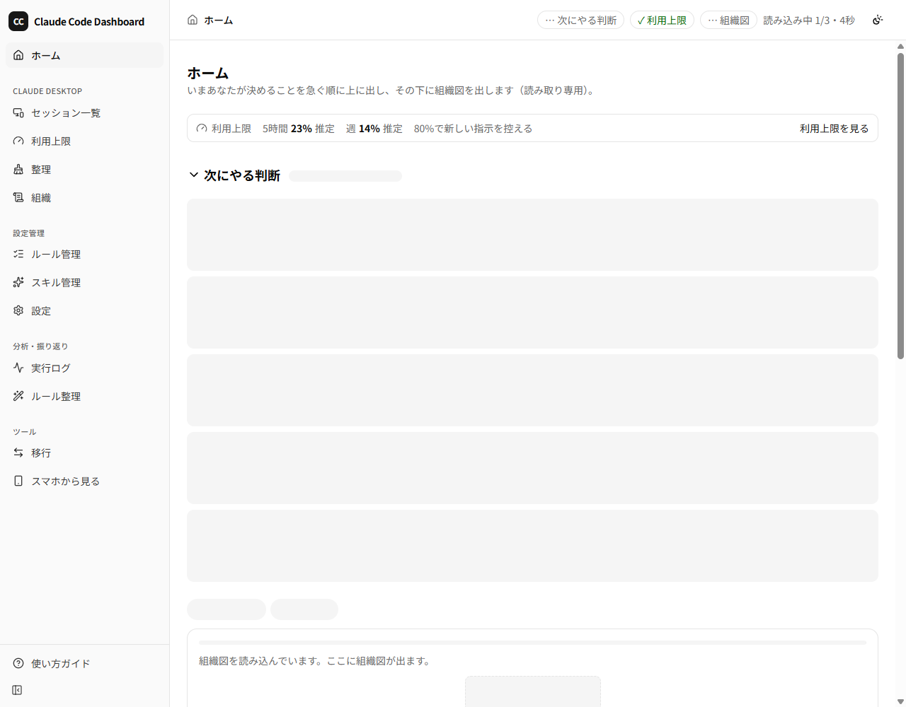

- 組織図で分かること：グループごとに、指揮役（タイトルが `00_` で始まるセッション）から各セッションへの指示と、各セッションからの報告の流れです。上のタブでグループを選びます。開いたときは、前回見ていたグループが出ます。
- 見方：
  - 指示は青い粒が下へ、報告は緑の粒が上へ流れます。指示は先頭20文字だけが線の横に出ます。報告の本文は出ません。
  - 報告をせずに終わったセッションには、灰色の「報告なしで終了」が出ます。作業中のカードは脈打ちます。
  - 他のグループや外部からの連絡は、指揮役のカードに紫の点線で入ります（「他グループ・外部」）。
  - コンテキストは80%で黄、90%で赤になります。
  - 子が作った補助のセッションは、その子のカードの下に字下げして並びます（3層目）。
  - 「作業量」のバーの長さは、ツール呼び出しの回数（量）です。100回で1周目が満杯になり、超えた分は、次の周の色（周ごとに濃くなる青緑）で満杯の上に左から伸びます（200回で全部が2周目の色）。2周目からは、回数の横に「2周目」のように出ます。長さと色は量で、警告ではありません。ツールは、Claude が作業で行う操作（ファイルの読み書き・コマンド・検索・送信など）のことで、スキルとは別物です。
  - サイドチャット（Claude Desktop の分岐の操作で作った脇の会話）は、カードになりません。親のカードに「サイドチャット」とその数だけが出ます（例：サイドチャット 1）。
- 「ライブ」は新しく起きた出来事だけを流します。「振り返り」では「再生」、「速さ」、「空き時間を飛ばす」、「再生位置」のスライダーで、過去の流れ（右上の選択で直近1時間・4時間・24時間）を再現できます。
- 「名前順」「作成順」で子のカードの並びを変えられます。

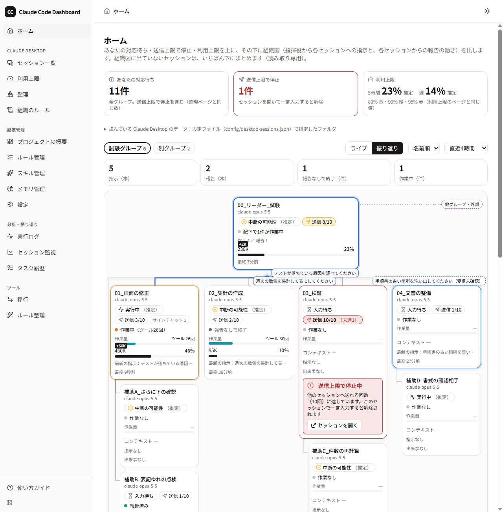
- いちばん下の「組織図に出ていないセッション」：ほかのグループ・指揮役のいないグループ・グループに入っていないセッションを、対応待ち（許可待ち・承認待ち・判断待ちなど）・実行中を先に10件まで並べます（アーカイブ済みとサイドチャットは除く）。行を押すと詳細が開きます。全部は「セッション一覧ですべて見る」から見ます。
- 以前の組織図のページ（`/desktop-sessions/org`）を開くと、ホームへ移ります。

### プロジェクトの概要

設定管理の入口です。選んでいるプロジェクトの名前とパス、「有効ルール数」「登録スキル数」「記録済みタスク数」「直近の 1-Shot 達成度」と、よく使うページへの入口が並びます（画像は [3-2](#3-2-ブラウザで起動する開発用)）。プロジェクトが未登録のときは「プロジェクトが未登録です」と出るので、右上の「+」から登録します。


### ルール管理

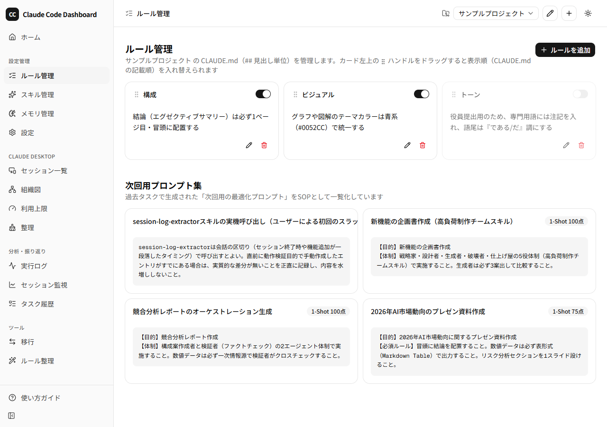

- 分かること：`CLAUDE.md` の `##` 見出し1つが1枚のカードです。上から順に、Claude Code に読まれる順番です。
- 操作：カードのスイッチで有効・無効、「ルールを追加」で追加、カードの左上のハンドルをドラッグして並び替え。編集・削除もカードから行います。
- 書き換えの直前の内容は、自動で退避されます（[設定](#設定) の「バックアップ」から戻せます）。
- 下の「次回用プロンプト集」は、実行ログに書かれた次回用の指示をまとめたものです。

### スキル管理

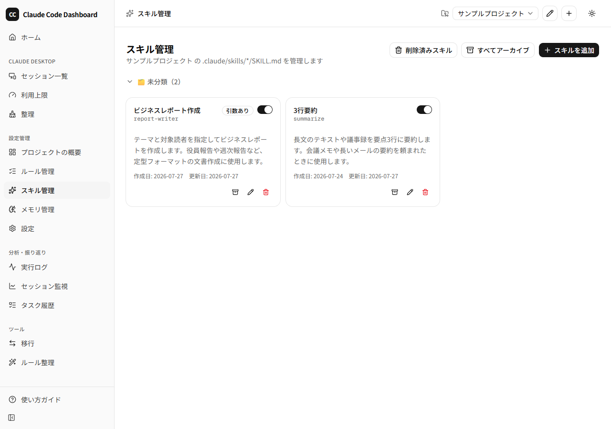

- 分かること：`skills/<名前>/SKILL.md` の一覧です。カテゴリ（例：「未分類」）を押すと開きます。
- 操作：「スキルを追加」、カードの鉛筆で編集（名前を変えると呼び出しのコマンドも変わります）、スイッチで有効・無効（無効にしたスキルは Claude Code から呼び出せません）。編集・改名の直前の `SKILL.md` は自動で退避され、[設定](#設定) の「バックアップ」から戻せます。
- アーカイブ：カードのアーカイブのボタンで「モデル別アーカイブ」を開き、今の版を対象のモデルごとに退避したり、前の版に切り替えたりできます。「すべてアーカイブ」で一度に退避できます。
- 削除：削除したスキルは完全には消えず、「削除済みスキル」から「復元する」で戻せます。
- 「発火が曖昧かもしれないスキルの組」が出たら、説明（description）が似ているスキルがあります。

### メモリ管理

`projects/*/memory/*.md`（Claude のメモリ）を種類ごとに読めます（読み取り専用）。`~/.claude` を登録したときに中身が出ます。サンプルプロジェクトにも合成のメモリが3件あります。

### 設定

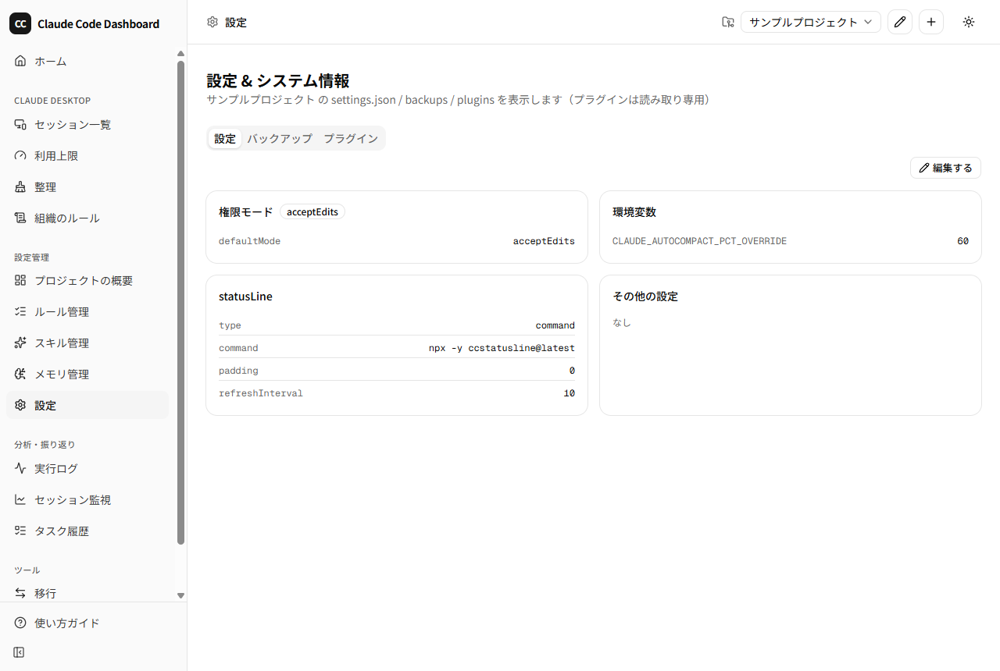

- 「設定」タブ：`settings.json` の権限モード・環境変数・statusLine などを表で見ます。「編集する」で JSON を直接書き換えられます。保存の前に確認が出て、保存の直前の内容は自動で退避されます。
- 「バックアップ」タブ：Claude Code が作るバックアップと、このアプリが書き換え・削除の直前に作った退避（`*.ccd-backup.<数字>`）が並びます。「復元する」で元に戻せます（戻す前の内容もさらに退避されます）。
- 「プラグイン」タブ：ブロックしているプラグインの一覧です（読み取り専用）。

### 実行ログ

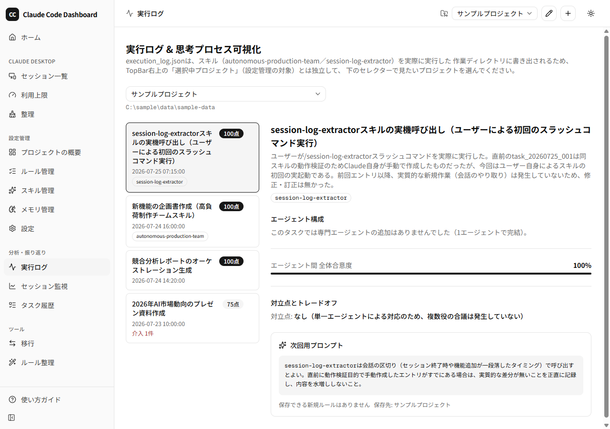

- 分かること：スキル（`autonomous-production-team` や `session-log-extractor`）が書いた `execution_log.json` の振り返りです。エージェントの構成、合意度、対立点とトレードオフ、利用者の介入、試行錯誤、次回用プロンプトが出ます。
- 上の選択欄で、ログを読むプロジェクトを選びます（右上の「選択中のプロジェクト」とは別です）。
- 「次回用プロンプト」は、選択中のプロジェクトの `CLAUDE.md` にルールとして保存できます。

### セッション監視

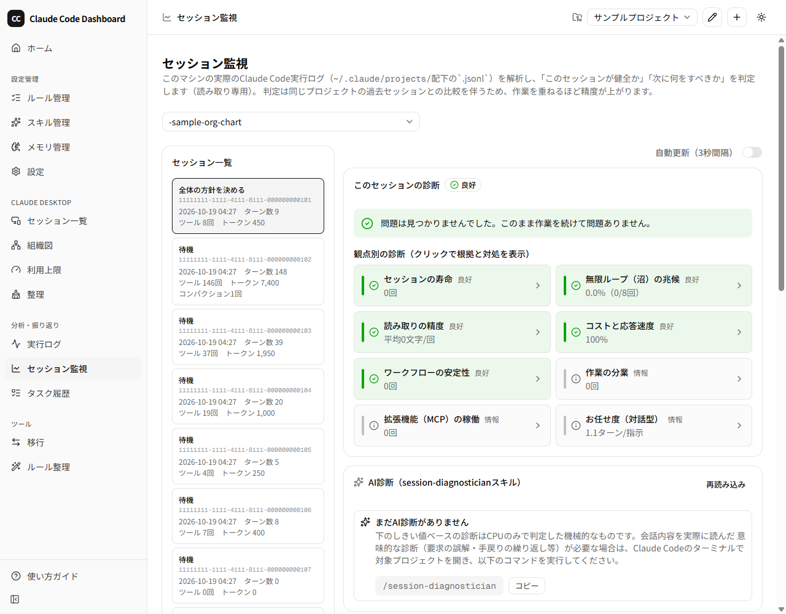

- 分かること：この PC の Claude Code の会話記録（`~/.claude/projects/` の下）から、1つのセッションの健全さを8つの観点で診断します。数字の根拠としきい値も出ます。
- 「自動更新（3秒間隔）」をオンにすると、作業中のセッションを見守れます。
- 「AI診断（session-diagnosticianスキル）」は、スキルが書いた診断の結果を表示します（このアプリは AI を呼びません）。

### Claude Desktop：セッション一覧

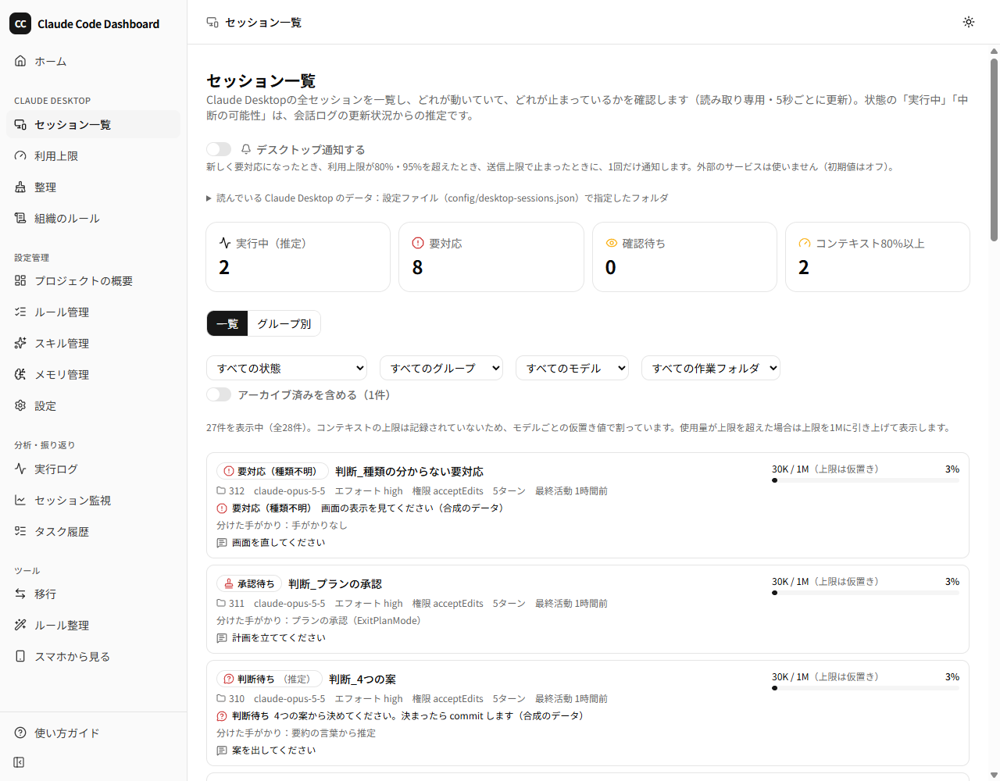

- 分かること：Claude Desktop の全セッションの状態・モデル・エフォート・コンテキストの使用量・進み具合・最新の指示（先頭60文字）です。5秒ごとに更新します。
- 上のカード（「実行中（推定）」「要対応」「確認待ち」と、コンテキスト80%以上の件数）を押すと、その状態だけに絞り込みます。「一覧」と「グループ別」を切り替えられます。
- 「実行中」「中断の可能性」は、会話記録の更新からの推定です。根拠は詳細に出ます。「中断の可能性」は、ツールの呼び出しのまま止まっているものです。許可の確認で止まっていることがあるので、詳細に「許可の確認が出ていないか、開いて確かめてください」と出ます。
- 要対応のセッションは、何をすればよいかで、次の4つに分けて出します（[要対応・確認待ち・完了の線引き](#要対応確認待ち完了の線引き)）。
- 行を押すと詳細が開きます。詳細の「セッション監視で詳しく診断する」で、セッション監視のページへ移れます。
- お知らせの欄の下に、読んでいる Claude Desktop のデータの出どころが1行で出ます（「設定ファイル（config/desktop-sessions.json）で指定したフォルダ」「自動で見つけたフォルダ」など）。押すと、フォルダの場所が出ます。ホームにも同じ行が出ます。
- サイドチャット（Claude Desktop の分岐の操作で作った脇の会話。Desktop のサイドバーには出ません）には「サイドチャット」の印が付き、どのセッションから開いたかが親の名前で出ます（例：サイドチャット（親：01_画面の修正））。
- 「デスクトップ通知する」をオンにすると、新しく要対応になったとき・利用上限が80%と95%を超えたとき・送信上限で止まったときに、1回だけ通知します（初期値はオフ）。「テスト通知」で試せます。
- アプリを起動した直後は、最新の指示に「解析中」と出ることがあります。会話記録を全部読み終わると、人の指示に置き換わります。

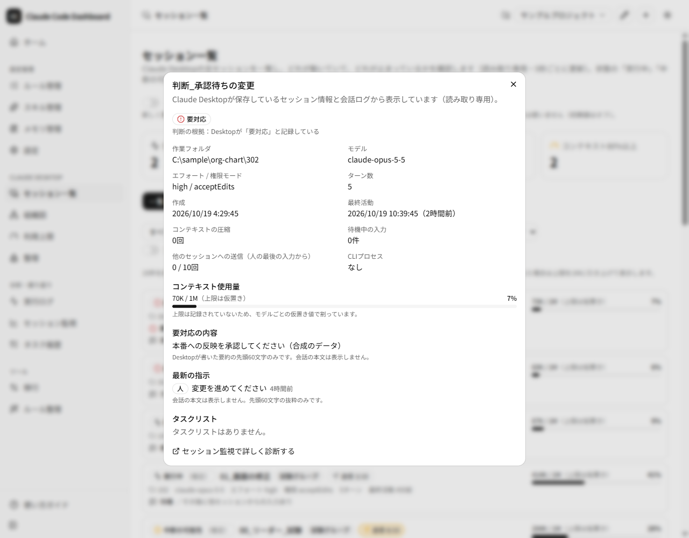

#### 要対応・確認待ち・完了の線引き

- 「要対応」「確認待ち」「完了」は、Claude Desktop がターンの終わりに付ける分類です。Dashboard が自分で要対応にするのは、回答待ち（質問〈AskUserQuestion〉かプランの承認〈ExitPlanMode〉を呼んだまま止まっているもの）だけです。
- Desktop が「要対応」にしたものを、Dashboard は手がかりから次の4つに分けます。待機は要対応に数えません（ホームと整理ページの「あなたの対応待ち」の数・通知にも入りません）。件数のカードの「あなたの対応待ち」は全部の合計で、種類の「判断待ち」とは別のものです。

| 表示 | 意味 | すること |
|---|---|---|
| 許可待ち | ツールの実行の許可を求めている | 開いて「許可」を押す |
| 承認待ち | コミット・PR の作成・マージ・プラン・外部への操作の承認を求めている | 開いて承認する |
| 判断待ち | 選ぶ・答える・決めることを求めている | 考えて答える |
| 待機 | 次の連絡や条件（担当の報告など）を待っているだけ | 何もしなくてよい |

- 分け方は、確かな手がかりを先に使います：質問・プランの承認で止まっている → 最後のターンのまとめ（wrap_up）の質問とボタン（質問が無ければ待機）→ Desktop の要約の言葉。要約の言葉から決めたものには「（推定）」と出ます。許可待ちは、確かな手がかりが無いので、いつも推定です。
- どれとも決められないものは「要対応（種類不明）」と出て、判断待ちと同じく数に入ります（見落とさないため）。
- 行と詳細に、要対応の内容（先頭60文字。要約に無ければ、wrap_up の質問の先頭60文字）と、分けた手がかり（例：「wrap_up のボタン（commit）」「要約の言葉から推定」）が出ます。

### Claude Desktop：利用上限・整理

[5章](#5-利用上限と送信上限) と [6章](#6-整理ページの使い方) で説明します。

### Claude Desktop：組織のルール

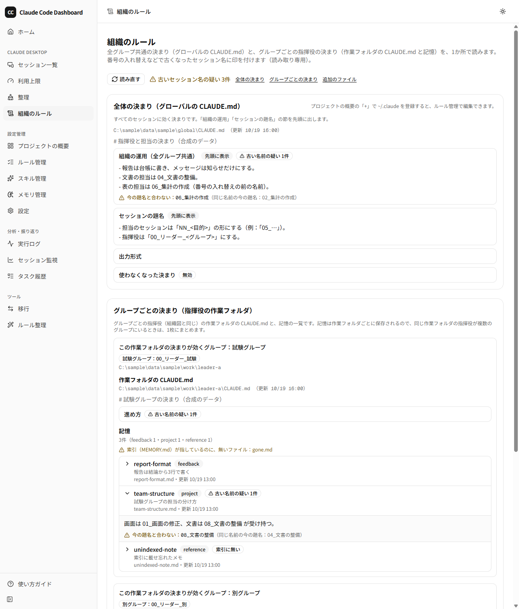

- 分かること：全グループ共通の決まりと、グループごとの指揮役の決まりです。忘れたときに、ここで読み返します（読み取り専用）。選んでいるプロジェクトとは関係しません。
- 全体の決まり：グローバルの CLAUDE.md（`~/.claude/CLAUDE.md`）を、見出し（`## `）ごとに出します。「組織の運用」「セッションの題名」の節を先頭に、開いた状態で出します。無効にした節には「無効」の印が付きます。編集するときは「ルール管理で編集する」を押します（グローバル設定のプロジェクトを選んだルール管理へ移ります。登録していなければ、その案内が出ます）。
- グループごとの決まり：組織図と同じ指揮役の作業フォルダの CLAUDE.md と、記憶の一覧（名前・説明・種類・更新日）です。記憶は作業フォルダごとに保存されるので、同じ作業フォルダの指揮役が複数のグループにいるときは、1枚にまとめて、効くグループを並べます。記憶の行を押すと本文が出ます。索引（MEMORY.md）に載っていない記憶には「索引に無い」、索引が指しているのに無いファイルには、その旨が出ます。
- 古いセッション名の印：本文の中の「2桁の数字＋_」で始まる名前（例：05_検証）が、今のセッションの題名と合わないとき、「今の題名と合わない」と出て、同じ名前・同じ番号の今の題名を添えます。ページの上に、印の合計が出ます。
- 追加のファイル：台帳などを足すときは、設定ファイル `config/org-rules.json` の `extraFiles` に、名前と場所を書きます（`.md` と `.txt`、1MB まで。見本は `config/org-rules.example.json`）。
- 読まないもの：指揮役でないセッションのフォルダの CLAUDE.md と記憶、認証情報などを含む可能性のあるファイル。WSL の作業フォルダ（`/home/...` など）は「この PC からは読めません」と出ます。
- 今の表示のしかた：
  - 本文は、Markdown として整えず、書いてあるとおりの文字で出します（`- ` などの記号もそのまま出ます。ルール管理と同じ）。
  - 記憶は、名前の順に200件までを出します。256KB を超える記憶は、一覧に「大きすぎて開けない」と出て、開くと「256KB を超えるため、本文を開けません。」と出ます。
  - 認証情報などの拒否リストに当たる名前の記憶（例：`credentials` で始まるもの）は、一覧に出ず、件数にも入りません。

### タスク履歴

`tasks/<セッション>/*.json`（Claude Code のタスク）を、セッションごとに進み具合のバーで見ます（読み取り専用）。

### 移行

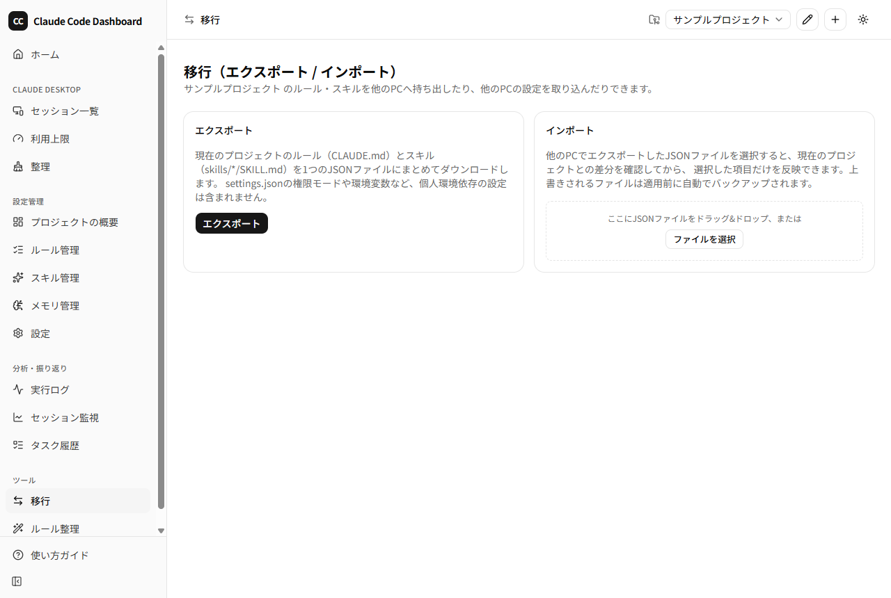

- 「エクスポート」：ルール（`CLAUDE.md`）とスキルを1つの JSON ファイルにまとめてダウンロードします。
- 「インポート」：別の PC で書き出した JSON を「ファイルを選択」（ドラッグ＆ドロップでも可）で選ぶと、今のプロジェクトとの差分が出ます。選んだ項目だけを反映します。上書きされるファイルは先に退避されます。
- 「移るもの・移らないもの」（ページの上）：
  - 移るもの：ルール（`CLAUDE.md` の「## 見出し」ごとの節。オン・オフも移る）と、スキル（`SKILL.md` の本文と、名前・説明などの見出しの項目）だけです。
  - 移らないもの：`CLAUDE.md` の最初の見出しより前の文、スキルの有効・無効（無効のスキルも、有効として入ります）、スキルのフォルダの中の `SKILL.md` 以外のファイルとアーカイブした過去の版、`settings.json`（「設定」のページで編集するもの）、記憶（メモリ）、MCP・プラグイン、このアプリのプロジェクトの登録と通知の設定。
  - インポートは、選んだ項目を足す・上書きするだけで、今あるルールやスキルは消しません。

### ルール整理

- 「1. rule-optimizerを実行する」：表示されたコマンドを「コピー」して、Claude Code で実行します（このアプリは実行しません）。
- 「2. 提案内容を確認して適用する」：スキルが書いた提案（`rule_refactor_proposal.json`）の差分を見て、選んだものだけを適用します。提案のあとで `CLAUDE.md` を変えた項目は選べません。適用の前に退避されます。

### スマホから見る

同じ家の Wi-Fi（LAN）につないだスマホから、ホーム・セッション一覧・利用上限・整理の4ページを、読み取り専用で見られるようにします。既定はオフです。

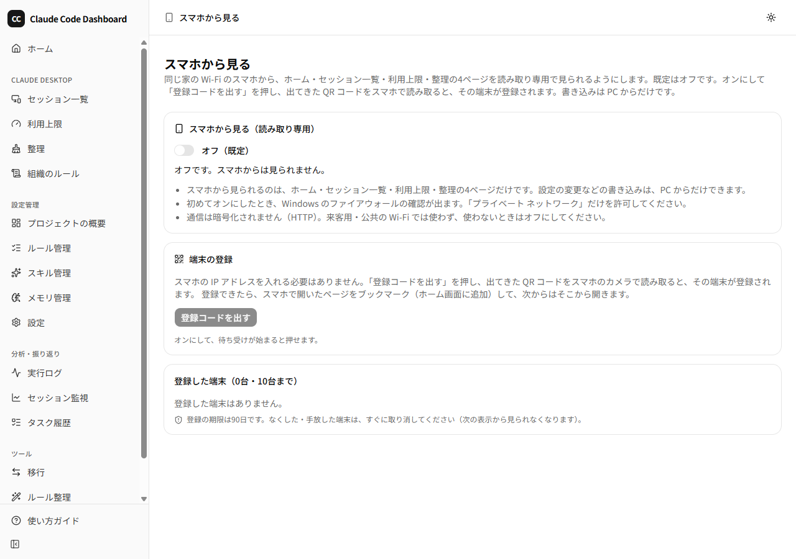

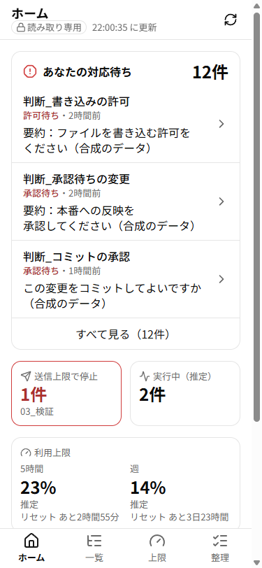

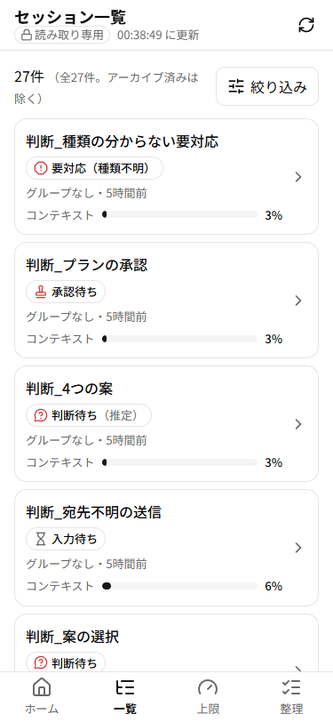

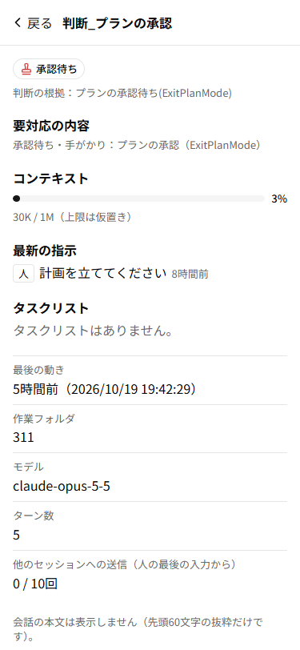

1. PC の画面で、サイドバーの「ツール」の「スマホから見る」を開き、スイッチをオンにします。数秒で「待ち受け中：http://192.168.x.x:38418」のように出ます。
   - 先に、家の Wi-Fi を Windows の設定でプライベート ネットワークにしておきます（設定 → ネットワークとインターネット → Wi-Fi → 使っているネットワーク → ネットワーク プロファイルの種類）。パブリックのままだと、次の確認で「プライベート ネットワーク」を許可しても、スマホから届きません。
   - 初めてオンにしたとき、Windows のファイアウォールの確認が出ます。「プライベート ネットワーク」だけを許可してください（「パブリック」は許可しません）。
   - 確認を閉じてしまったときは、「Windows セキュリティ」→「ファイアウォールとネットワーク保護」→「ファイアウォールによるアプリケーションの許可」で許可します。
2. 「登録コードを出す」を押すと、QR コードと8文字のコードが出ます。コードは5分だけ・1回だけ使えます。
3. スマホのカメラで QR コードを読み取って開くと、その端末が登録され、ホームが開きます。QR を読めないときは、画面に出る URL をスマホのブラウザで開きます。
4. 開いたページをブックマーク（ホーム画面に追加）して、次からはそこから開きます。チャットのアプリなど、別のアプリのリンクから開くと、登録の案内が出ることがあります（そのときはブックマークから開き直します）。

- **スマホの IP アドレスは入れません。** 家のルーターはスマホの IP アドレスを変えることがあり、同じ Wi-Fi の別の機器がその IP アドレスを名乗ることもできるため、IP アドレスで許す方式にはしていません。QR コードで登録した端末だけが見られます。
- スマホでは、スマホ用の画面で出ます（URL は PC と同じです）。最初の画面に、あなたの対応待ち（件数と上位3件・何を待っているか）・送信上限で停止・実行中の数・利用上限（5時間と週）が出ます。下の4つのタブ（ホーム・一覧・上限・整理）で移り、セッションを押すと詳細が全画面で開きます（戻るで閉じます）。
- スマホの画面は15秒ごとに読み直し、画面を閉じているあいだは止まります。上のバーに最後に読み直した時刻が出て、右上のボタンですぐに読み直せます。ライト・ダークは、スマホの設定に合わせます。
- 書き込み（設定の変更・通知のスイッチなど）は PC からだけです。スマホには、通知のスイッチや「Claude Desktop で開く」のボタンは出ません。組織図の代わりに、グループごとの短い一覧が出ます。作業フォルダのパスは、最後のフォルダ名だけを出します。
- 登録の期限は90日です。登録した端末は10台までで、一覧から端末ごとに名前を変えたり、取り消したりできます。なくした・手放した端末は、すぐに取り消してください。
- 通信は暗号化されません（HTTP）。同じ Wi-Fi の人には、見ている中身を盗み見られるおそれがあります。来客用・公共の Wi-Fi では使わず、使わないときはオフにしてください。
- 待ち受けの番号 38418 がほかのアプリに使われているときは、画面に「番号 38418 が使用中のため、<IP アドレス> で待ち受けられません」と出ます。

### 使い方ガイド（アプリの中）

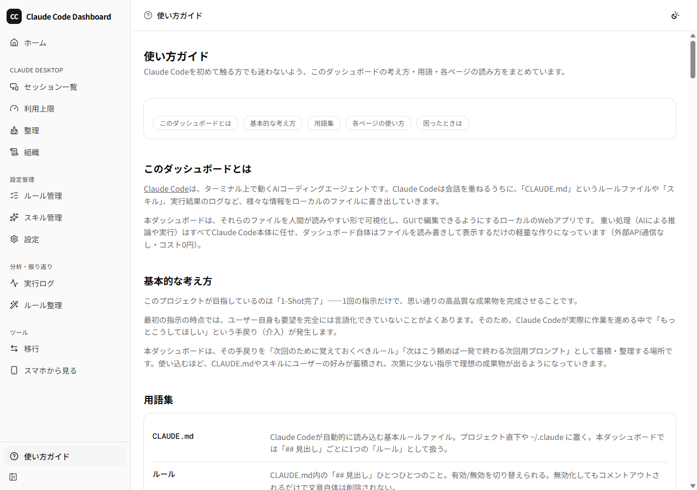

用語の意味、各ページの短い説明、よくある質問があります。

---

## 5. 利用上限と送信上限

### 5-1. 利用上限（「利用上限」のページ）

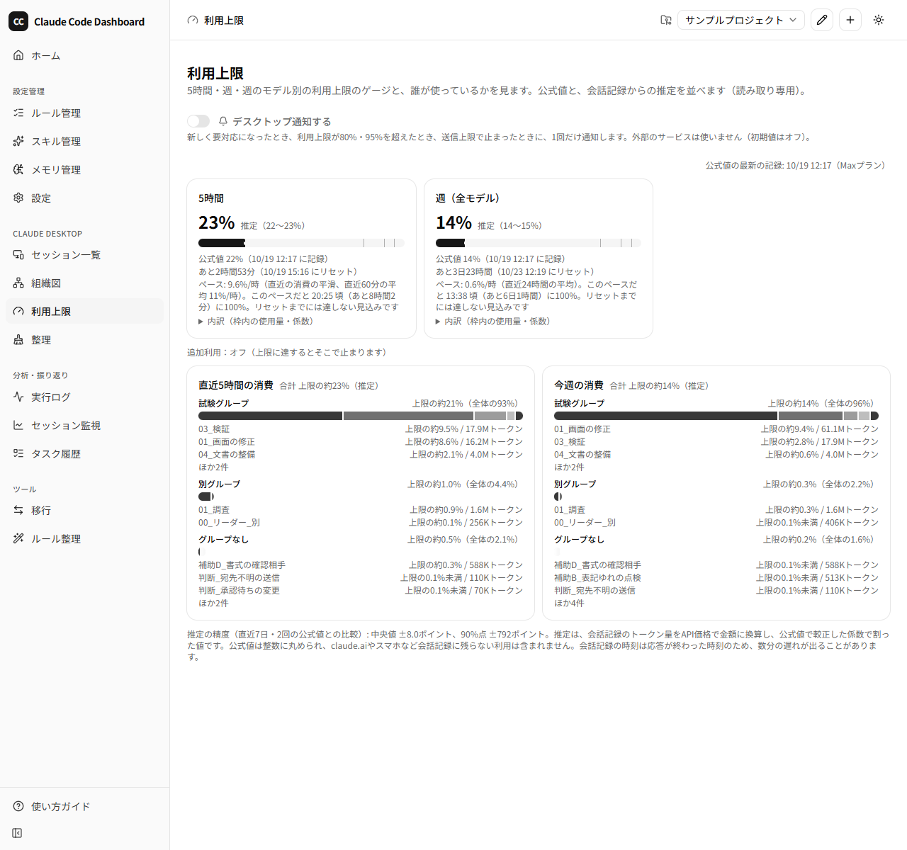

| 見るところ | 意味 |
|---|---|
| ゲージ（5時間・週〈全モデル〉・週〈モデル別〉） | 上限をどれだけ使ったか。80%以上で黄（「注意（80%以上）」）、90%以上で橙（「警戒（90%以上）」）、95%以上で赤（「危険（95%以上）」）。色は画面に出す丸めた%で決めます（94.6%は95%と出て、赤になります） |
| 公式値と推定 | 公式値は、指揮役のセッションが記録した Anthropic の値です。記録と記録の間は、会話記録から求めた推定で埋め、推定（22〜23%）のように幅で出します |
| リセットまでの時間 | あと2時間57分（10/19 11:19 にリセット）のような形で出ます |
| ペース | 今のペースで何時に100%になるか。リセットより先に達する見込みなら警告します。差が小さいとき（5時間は15分以内・週は2時間以内）は「リセットとほぼ同時」と出ます |
| 直近5時間の消費・今週の消費 | 誰が使っているかを、グループ別・セッション別の棒で出します。長さは上限の何%に当たるかです（ドルは請求額と誤解されるため出しません） |
| 推定の精度 | 直近7日の公式値と、推定のずれ（中央値と90%点） |

公式値は `~/.claude-dashboard/usage-snapshots.jsonl` から読みます（このアプリは書きません）。記録が無いときは「公式値の記録が見つかりません」と出て、ゲージは出ず、消費の棒だけが出ます。記録の形は [付録 9-2](#9-2-利用上限の記録の形) にあります。

### 5-2. 上限ガードの帯

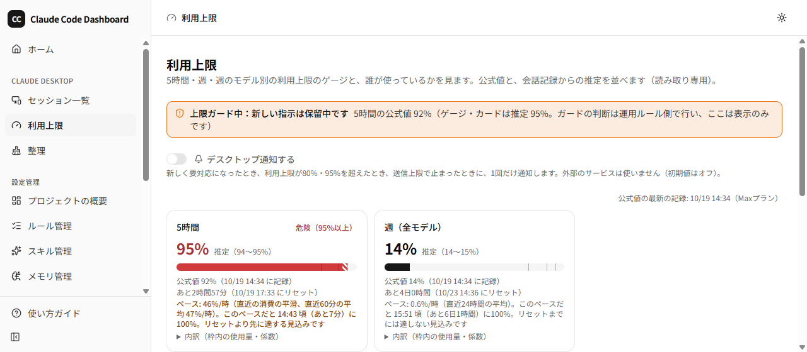

最新の公式値が80%以上になると「上限に近づいています」、90%以上になると「上限ガード中：新しい指示は保留中です」が、ホームと Claude Desktop の3ページの上に出ます。

- この帯は表示だけです。セッションを止める、指示を保留・再送するのは、指揮役のセッションの運用（80%で報告、90%で新しい指示を保留、95%で実行中のセッションを止める、リセット後に再送）です。このアプリにセッションを止める機能はありません。
- 帯は公式値だけで決まります（推定では出ません）。
- 帯の%は最新の公式値で、ゲージとホームのカードの%は推定を含む値です。丸めた値が違うときは、帯に推定の%も添えます（例：5時間の公式値 92%（ゲージ・カードは推定 95%。…））。

### 5-3. 送信上限

Claude Desktop では、あるセッションから他のセッションへメッセージを送れるのは、人が最後に入力してから10回までです。

- 各セッションに「送信 n/10」が出ます。8回以上で黄、10回で赤になります。届かなかった送信も数えます。
- 10回に達して止まると、「送信上限で停止中」が赤で出て、「セッションを開く」のボタンが出ます。
- 対処：「セッションを開く」で Claude Desktop のそのセッションを開き、一言入力します。人の入力で回数が0に戻り、送れるようになります。他のセッションからのメッセージでは戻りません。
- 「デスクトップ通知する」をオンにしていれば、新しく止まったときに通知が出ます。

---

## 6. 整理ページの使い方

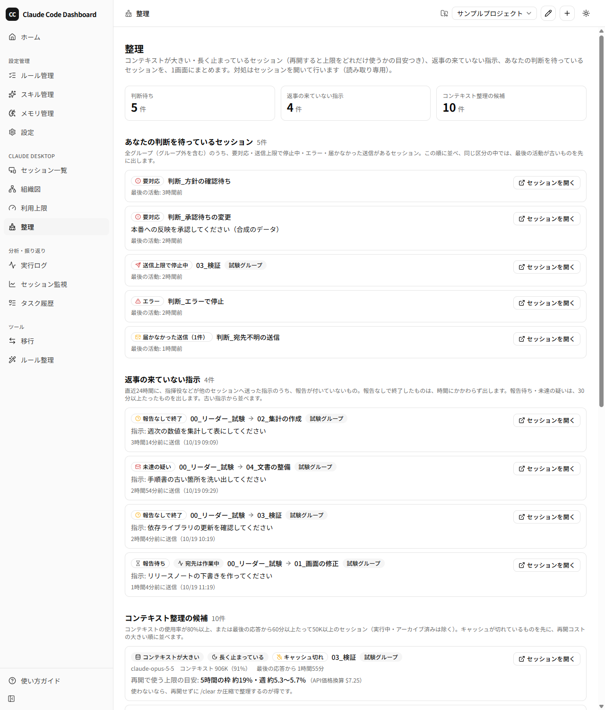

「整理」のページは、たまったセッションを片づけるための1画面です。上から次の3つの節が並びます。各節は上位20件を出し、残りは「すべて表示」で開きます。

| 節 | 出るもの |
|---|---|
| 「あなたの対応待ち」 | 要対応・送信上限で停止中・エラー・届かなかった送信があるセッション（グループの外も含む）。すぐ押せるものから、許可待ち、承認待ち、判断待ち、送信上限で停止中、エラー、届かなかった送信の順。待機は入りません |
| 「返事の来ていない指示」 | 直近24時間の指示のうち、報告が付いていないもの。「報告なしで終了」（時間に関係なく）、「報告待ち」（相手が受け取って30分以上）、「未達の疑い」（送った記録だけで30分以上）。相手が作業中なら「宛先は作業中」 |
| 「コンテキスト整理の候補」 | コンテキストの使用率が80%以上、または最後の応答から60分以上たって50K以上のセッション（実行中・アーカイブ済みは除く） |

### 見る順番の例

1. 「あなたの対応待ち」を見る → 上の許可待ち・承認待ちから「セッションを開く」で開いて押し、次に判断待ちに答える。
2. 「返事の来ていない指示」を見る → 「報告なしで終了」は、相手が報告せずに終わった指示です。相手のセッションを開いて状況を確かめるか、指揮役に再指示を頼みます。「未達の疑い」は、相手が受け取った記録が無い指示です。
3. 「コンテキスト整理の候補」を見る → 使わないセッションは、再開せずに `/clear` か圧縮をします。

### 再開コストとキャッシュ

- Claude は直前のやりとりを1時間だけ覚えておき（プロンプトキャッシュ）、その間に再開すると安く続けられます。最後の応答から1時間たつと「キャッシュ切れ」になり、再開した最初の応答でコンテキスト全体を書き直します。
- 「再開で使う上限の目安」は、その書き直しの量です（コンテキスト量×入力単価×2 を、利用上限の公式値で割合にしたもの）。5時間の枠 約3〜4%・週 約0.4% のような形で出ます。金額は API 価格に換算したもので、請求額ではありません。
- 並びは、キャッシュが切れているもの → 最後の応答の時刻が分からないもの（「キャッシュ不明」。切れていた場合の目安）→ キャッシュが有効なもの、の順です。

### 行の押し方

- 行の空いているところを押すと、セッションの詳細が開きます。
- 「セッションを開く」は、Claude Desktop でそのセッションを開きます（`claude://` のリンク。許可した形のものだけ）。

### しきい値を変える

`config/desktop-sessions.json`（exe では `%APPDATA%\claude-code-dashboard\config\desktop-sessions.json`）の `housekeeping` で変えられます。変えたらアプリを起動し直します。

```json
{
  "housekeeping": {
    "idleMinutes": 60,
    "minIdleTokens": 50000,
    "unansweredMinutes": 30
  }
}
```

会話記録が読めないセッションがあるときは、件数つきのお知らせ（例：1件のセッションは会話ログを読めないため判定できません。）が出ます。

---

## 7. 安全の設計と、自分で確かめる方法

| 設計 | 内容 |
|---|---|
| このPCの中だけで待ち受ける | 開発サーバーも exe も `127.0.0.1` だけで待ち受けます。同じ LAN の他の PC からは開けません。「スマホから見る」をオンにしたときだけ、別の入り口（番号 38418）が家の LAN の IP アドレスで待ち受け、登録した端末の読み取り（4ページ）だけを通します。書き込みは、入り口で必ず断ります |
| 他のサイトからの要求を拒む | すべての API で、送り先（Host）が `127.0.0.1`・`localhost`・`[::1]` 以外の要求と、他のサイトからの書き込みを拒否します |
| 外と通信しない・AI を呼ばない | 外部のサービスや LLM を呼びません。費用は0円です |
| 読むだけのもの | Claude Desktop のデータ、会話記録、メモリ、タスク履歴、プラグインの一覧、利用上限の記録 |
| 書き込むもの | 操作したときの `CLAUDE.md`・スキル・`settings.json`・`.claude.json`（復元のときだけ）・実行ログ・このアプリ自身の設定。書き換え・削除の前に必ず退避し、退避できなければ書き込みません |
| 認証情報を読まない | `.credentials.json` や、Claude Desktop の `config.json`（ログインの情報が入っている）は開きません。ファイルのプレビューでも、鍵や `.env` などは表示しません |
| 会話の本文を出さない | 出すのは、最新の指示と要対応の内容の先頭60文字、組織図の指示の先頭20文字などの抜粋だけです |
| exe の窓 | アプリ以外のページへの移動や新しい窓を止めます。開けるのは、許可した形の `claude://` のセッションのリンクだけです |

### 自分で確かめる

ブラウザで起動している（`npm run dev`）ときの例です。exe では、ポートを 38417 に読み替えてください。コマンドは Windows のコマンドプロンプトか PowerShell で実行します（PowerShell では `curl` ではなく `curl.exe` と書きます）。

1. 待ち受けているアドレスを見る

   ```bash
   netstat -ano | findstr :3000
   ```

   → `LISTENING` の行の左側が `127.0.0.1:3000` だけです。`0.0.0.0:3000` や LAN のアドレスはありません。

2. 送り先（Host）を偽った要求が拒否されることを見る

   ```bash
   curl.exe -s -H "Host: example.com" http://127.0.0.1:3000/api/projects
   ```

   → `{"error":"許可されていないHostです"}` が返ります（状態コード 403）。

3. 他のサイトからの書き込みが拒否されることを見る

   ```bash
   curl.exe -s -X POST -H "Origin: http://evil.example" -H "Content-Type: application/json" -d "{}" http://127.0.0.1:3000/api/rules
   ```

   → `{"error":"許可されていないOriginです"}` が返ります（状態コード 403）。ルールは変わりません。

4. 認証情報らしいファイルがプレビューされないことを見る：中身が空の `.env` を作ったフォルダを、「プロジェクトを追加」のツリーで開き、`.env` を押す
   → 中身は表示されず、赤い文字で「認証情報・秘密鍵を含む可能性があるため、このファイルはプレビューできません」が出ます。試したら、作った `.env` は消してください。

---

## 8. 困ったとき

| 症状 | 原因 | 対処 |
|---|---|---|
| `npm run dev` で `Port 3000 is in use` と出る。または `http://127.0.0.1:3000` を開くと別のアプリが出る | 別のアプリや、前に起動したサーバーが3000番を使っている。このときサーバーは止まらず、3001 などの空いているポートで起動している | `Local:` の行に出たアドレス（例：`http://127.0.0.1:3001`）を開けば、そのまま使える。3000番で使いたいときは、前に起動したサーバーを Ctrl + C で止めてから起動し直す。使っているものは `netstat -ano \| findstr :3000` の右端の番号（PID）で分かる |
| exe で「別のポートで起動しました」と出る | 優先ポート38417が、ほかのアプリか、前回のサーバーの残りに使われている | そのままでも使える。ただしこの起動の間は、サイドバーの畳み方や絞り込みなど画面の設定が別扱いになる。前回の exe が残っていれば終わらせてから起動し直す |
| 画面の設定（サイドバーの畳み方・絞り込み）が引き継がれない | 上と同じで、別のポートで起動している | 38417 を空けてから起動し直す |
| exe の起動に20秒以上かかる。窓がなかなか出ない | portable exe が、起動のたびに自分を一時フォルダへ展開している（展開の間は、案内の文の画像だけが出る） | 仕様です。遅い PC では、起動のたびに、窓が出るまで30秒以上かかることがあります。何度も開かず、待ってください。 |
| 起動中に「まだ準備中です」と出る | PC が遅い・ほかの処理で混んでいて、前回の起動の3倍（最低60秒）を過ぎても準備が終わっていない | ［待つ］を押す（待ち続け、同じ時間がたつとまた聞く）。やめたいときは［やめる］。段階ごとの時間は、設定の保存先（`%APPDATA%\claude-code-dashboard`）の `startup-stats.json` に残る（時間と結果だけ） |
| ホームの欄に「時間がかかっています（30秒以上）。このまま待てます。」と出る | PC が遅い・混んでいる、またはデータが大きく、サーバーの答えに時間がかかっている（要求は切っていない） | そのまま待てば、答えが来た時点で出る。［もう一度読み込む］で出し直すこともできる（出し直しても、重い計算は増えない） |
| ホームの欄に「読み込めませんでした」と出る | サーバーがその欄の読み込みに失敗した、またはサーバーにつながらなかった | ［もう一度読み込む］を押す。ほかの欄はそのまま使える。続くときは、アプリを起動し直す |
| `%TEMP%` に `nsXXXX.tmp` というフォルダ（約1.7GB）が残っている | exe を強制終了した、または PC が異常終了した。exe は起動のたびに別の一時フォルダへ展開し、ふつうに閉じたときだけ消す | アプリを閉じてから、そのフォルダごと消す（開いている間のフォルダは消さない） |
| SmartScreen の警告が出て起動できない | コード署名をしていない | 『詳細情報』→『実行』 |
| 「プロジェクトの概要」に「プロジェクトが未登録です」と出る | exe のはじめての起動では、プロジェクトが登録されていない | 「プロジェクトの概要」の右上の「+」から、`CLAUDE.md` や `skills/` のあるフォルダを登録する |
| ホームや「セッション一覧」が0件、または Desktop のデータが読めない旨の警告が出る | Claude Desktop のデータフォルダが見つからない（通常のインストーラー版は自動で探せないことがある） | `config/desktop-sessions.json` の `dataDir`（Desktop のデータフォルダ）と `projectsRoot`（`~/.claude/projects`）を書いて、起動し直す。環境変数 `CLAUDE_DESKTOP_DATA_DIR` でもよい |
| ホームや「セッション一覧」に「自動で探すのを止めています（CCD_DESKTOP_AUTODETECT=0）」と出て、0件になる | 撮影・確認用のスイッチ（環境変数 `CCD_DESKTOP_AUTODETECT=0`）を付けて起動している | ふだん使うときは、この環境変数を外して起動し直す。付けたまま使うときは、`config/desktop-sessions.json` に `dataDir` と `projectsRoot` を書く |
| 「組織のルール」に、グループの決まりが出ない | そのグループに指揮役（タイトルが 00_ で始まるセッション）がいない。または Claude Desktop のデータが見つからない | 指揮役の名前を 00_ で始める。接頭辞を変えているときは `config/desktop-sessions.json` の `orchestratorPrefix` を確かめる |
| 「組織のルール」の記憶に「記憶の場所が分かりません」「この PC からは読めません」と出る | 指揮役の会話記録が見つからない。または作業フォルダが WSL の中にある | 会話記録の場所（`projectsRoot`）を確かめる。WSL の作業フォルダは読めない（今は対応していない） |
| 「縮退表示」のお知らせが出る（Desktopのセッション情報を読めないため、会話ログだけで一覧を作っている） | Desktop のデータが読めず、会話記録だけで一覧を作っている（グループやピン留めは出ない） | 上と同じく、データフォルダの場所を設定する |
| 状態が「実行中」のまま変わらない | 実行中は会話記録の更新からの推定で、更新が続くと実行中に見える | 詳細の「判断の根拠」を見る。しきい値（45秒・11分）は `config/desktop-sessions.json` の `runningWindowSec`・`pendingWindowSec` で変えられる |
| 利用上限にゲージが出ず「公式値の記録が見つかりません」と出る | `~/.claude-dashboard/usage-snapshots.jsonl` が無い | 指揮役のセッションの運用で記録してもらう。場所が違うときは `config/usage.json` の `snapshotsPath` で指定する |
| 組織図に線が引かれず、「指揮役のセッションが見つかりません」と出る | グループに、タイトルが `00_` で始まるセッションが無い | 指揮役のセッションの名前を `00_` で始める。別の接頭辞にしたいときは `config/desktop-sessions.json` の `orchestratorPrefix` を変えて、起動し直す |
| 合成データを作り直したのに、組織図や整理が古いまま | 会話記録を差分で読むので、同じ場所に作り直すと前の内容が残る | アプリを起動し直す |
| スマホからページが開けない（読み込みが終わらない・つながらない） | PC とスマホが同じ家の Wi-Fi にいない、家の Wi-Fi が Windows でパブリック ネットワークになっている、ファイアウォールで許可していない、またはその端末を登録していない | 同じ家の Wi-Fi につなぐ。Wi-Fi をプライベート ネットワークにする。「Windows セキュリティ」→「ファイアウォールとネットワーク保護」→「ファイアウォールによるアプリケーションの許可」で「プライベート ネットワーク」だけを許可する。「スマホから見る」で登録コードを出して、端末を登録し直す。詳しくは [スマホから見る](#スマホから見る) |
| 通知が出ない | 「デスクトップ通知する」がオフ、またはブラウザで通知が許可されていない | スイッチをオンにして「テスト通知」を押す。ブラウザなら、このサイトの通知を許可する |
| ルールやスキルを消してしまった・書き換えを戻したい | — | ルール・スキルの書き換え・設定・実行ログは「設定」→「バックアップ」→「復元する」。消したスキルは「スキル管理」→「削除済みスキル」→「復元する」。退避は同じ対象ごとに新しい順に30世代・90日まで残る（直近5世代は期間にかかわらず残る） |
| 「最新の指示」に「解析中」と出る | 起動の直後で、会話記録の末尾だけを読んだ暫定の表示 | しばらく待つ（全部読み終わると置き換わる） |

---

## 9. 付録

### 9-1. 設定ファイルの場所

| ファイル | ブラウザ（開発用） | exe |
|---|---|---|
| プロジェクトの登録 | `config/projects.json` | `%APPDATA%\claude-code-dashboard\config\projects.json` |
| Desktop セッションの設定（データフォルダ・指揮役の接頭辞・しきい値） | `config/desktop-sessions.json`（見本は `config/desktop-sessions.example.json`） | 同じフォルダの `config\desktop-sessions.json` |
| 利用上限の設定（価格表・記録の場所） | `config/usage.json`（見本は `config/usage.example.json`） | 同じフォルダの `config\usage.json` |
| 通知のオン・オフ | `config/desktop-notify.json`（画面のスイッチで作られる） | 同じフォルダの `config\desktop-notify.json` |
| スマホから見る（オン・オフ・登録した端末・登録コード・待ち受けの状態） | `config/lan-access.json`・`lan-devices.json`・`lan-pairing.json`・`lan-status.json`（画面の操作で作られる。鍵とコードはハッシュだけを保存） | 同じフォルダの `config\lan-*.json` |

### 9-2. 利用上限の記録の形

`~/.claude-dashboard/usage-snapshots.jsonl` は、1行に1件の JSON です。次は架空の例です（読み取られるのは窓・時刻・プラン・追加利用だけで、記録した人の欄は読み捨てられます）。

```json
{"ts":"2026-10-19T08:00:00.000Z","source":"get_usage","recordedBy":"example","plan":"Max","windows":[{"key":"five_hour","label":"5-hour limit","percentUsed":22,"resetsAt":"2026-10-19T11:00:00.000Z"},{"key":"weekly_all","label":"Weekly · all models","percentUsed":14,"resetsAt":"2026-10-23T08:00:00.000Z"}],"extraUsage":{"enabled":false,"spent":null}}
```

### 9-3. このガイドの画像の撮り方

画像は、実データに触れないよう、合成データだけを向けた専用のサーバーで撮りました。次の手順で同じ画面を再現できます。例では、撮影用のフォルダを `%TEMP%\ccd-sample`（PowerShell では `$env:TEMP\ccd-sample`）とし、コマンドは PowerShell で書きます。一時フォルダは `%TEMP%` の下に作り、`C:\` の直下には作りません。

1. 合成の Desktop データを作る

   ```bash
   node scripts/make-org-chart-sample.mjs "$env:TEMP\ccd-sample\data\sample"
   ```

   → `%TEMP%\ccd-sample\data\sample` の下に `data`（Desktop のデータ）・`projects`（会話記録）・`usage-snapshots.jsonl`（架空の利用上限の記録）ができ、`dataDir`・`projectsRoot`・`snapshotsPath` が表示されます。期待値は `expected.json` にも書かれます（手順6の確認が読みます）。

2. リポジトリの `sample-data/` を、撮影用のフォルダに写す

   ```bash
   Copy-Item -Recurse sample-data "$env:TEMP\ccd-sample\data\sample-data"
   ```

   → `%TEMP%\ccd-sample\data\sample-data` に、`CLAUDE.md`・`skills`・`execution_log.json` などができます。

3. `%TEMP%\ccd-sample\data\config\` に、次の4つのファイルを作る
   → サーバーは、`CCD_DATA_DIR` の下の `config/` を、リポジトリの `config/` の代わりに読みます。
   → 表の `<撮影用>` は、撮影用のフォルダの実際の場所に置き換えます（例：`C:\\Users\\<名前>\\AppData\\Local\\Temp\\ccd-sample`。JSON の中では `\` を `\\` と書きます）。

   | ファイル | 中身 |
   |---|---|
   | `projects.json` | `{"projects":[{"id":"sample","name":"サンプルプロジェクト","path":"<撮影用>\\data\\sample-data"}],"selectedProjectId":"sample"}` |
   | `desktop-sessions.json` | `{"dataDir":"<撮影用>\\data\\sample\\data","projectsRoot":"<撮影用>\\data\\sample\\projects"}`（手順1で表示された値） |
   | `usage.json` | `{"snapshotsPath":"<撮影用>\\data\\sample\\usage-snapshots.jsonl","projectsRoot":"<撮影用>\\data\\sample\\projects"}`（手順1で表示された値） |
   | `org-rules.json` | `{"globalClaudeMdPath":"<撮影用>\\data\\sample\\global\\CLAUDE.md","extraFiles":[{"label":"台帳（合成のデータ）","path":"<撮影用>\\data\\sample\\extras\\ledger.md"}]}`（手順1で表示された値。「組織のルール」を撮るとき） |

4. リポジトリの複製（一時フォルダ）でビルドする

   ```bash
   npx next build --webpack
   ```

   → 終了コード0で終わります。

5. 本物のデータを自動で探さないスイッチを付け、環境変数を撮影用のフォルダに向けて、専用のポートで起動する

   ```bash
   $env:CCD_DESKTOP_AUTODETECT='0'; $env:CLAUDE_DESKTOP_PROJECTS_ROOT="$env:TEMP\ccd-sample\data\sample\projects"; $env:CCD_DATA_DIR="$env:TEMP\ccd-sample\data"; $env:USERPROFILE="$env:TEMP\ccd-sample\home"; $env:HOME="$env:TEMP\ccd-sample\home"; $env:APPDATA="$env:TEMP\ccd-sample\home\AppData\Roaming"; $env:LOCALAPPDATA="$env:TEMP\ccd-sample\home\AppData\Local"; npx next start -H 127.0.0.1 -p 3961
   ```

   → `Ready` が出ます（`output: standalone` についての警告が出ますが、起動します）。`http://127.0.0.1:3961/desktop-sessions` を開くと、「縮退表示」のお知らせは出ず、試験グループ・別グループのセッションと、グループに入っていない判断待ちのセッション（あわせて28件）が出ます。お知らせの欄の下には、読んでいるデータが「設定ファイル（config/desktop-sessions.json）で指定したフォルダ」だと出ます。
   - `CCD_DESKTOP_AUTODETECT=0` は、設定ファイルか環境変数で指定した場所だけを読み、この PC の本物の Claude Desktop のデータ・会話記録・利用上限の記録を自動で探さないようにするスイッチです。手順3の設定ファイルが無くても、本物のデータは読みません（配布 exe はこのスイッチを使わず、今までどおり自動で探します）。
   - `CLAUDE_DESKTOP_PROJECTS_ROOT` は、会話記録の場所です。スイッチを付けると、「セッション監視」もこの場所だけを読みます。
   - `USERPROFILE`・`HOME`・`APPDATA`・`LOCALAPPDATA` も撮影用のフォルダに向けるのは、念のための二重の守りです。

6. 撮る前に、サーバーが合成データだけを読んでいるかを確かめる

   ```bash
   node scripts/check-sample-server.mjs http://127.0.0.1:3961 "$env:TEMP\ccd-sample\data\sample"
   ```

   → 合成データだけを読んでいる旨（出どころと件数）が出て、終了コード0で終わります。読んでいる場所が設定ファイルか環境変数での指定でないとき、件数が合成データ（手順1で作った `expected.json`）と違うとき、またはセッションの ID が `expected.json` の ID と一致しないとき（件数がたまたま同じ別のデータを読んでいるとき）は、理由を出して終了コード1で終わります。そのときは撮らずに、手順3と手順5を見直します。

7. 幅1280ピクセル・ライトテーマの窓で各ページを開いて撮る
   → このガイドでは Electron の `webContents.capturePage()` で撮りました（撮影用のスクリプトはリポジトリに入れていません。撮影のスクリプトは、最初に手順6の確認を実行し、終了コードが0でなければ撮らずに止まります）。ブラウザのスクリーンショット機能で撮っても同じ画面になります。

8. 上限ガードの帯を撮るときは、サーバーを止めて、手順1を `--guard` を付けて実行し直し（`node scripts/make-org-chart-sample.mjs --guard "$env:TEMP\ccd-sample\data\sample"`）、手順5で起動し直し、手順6で確かめる
   → ページの上部に「上限ガード中：新しい指示は保留中です」の帯が出ます。撮り終えたら、`--guard` を付けずに作り直します。

9. サーバーを Ctrl + C で止め、撮影用のフォルダと複製を消す
   → 手元に合成データが残りません。

### 9-4. 用語

| 用語 | 意味 |
|---|---|
| 指揮役 | グループの中で、各セッションに指示を出し、報告を受けるセッション。タイトルが `00_` で始まる |
| 公式値 | 指揮役のセッションが記録した、Anthropic の利用率（5時間・週） |
| 推定 | 公式値の間を、会話記録のトークン量から求めた値。幅つきで出る |
| 上限ガード | 利用上限が近いときに、新しい指示を控える・止める指揮役の運用。アプリは帯で示すだけ |
| 送信上限 | 他のセッションへの送信が、人が最後に入力してから10回までに限られていること |
| キャッシュ切れ | 最後の応答から1時間たち、再開のときにコンテキスト全体を書き直す状態 |
| 退避 | 書き換え・削除の直前に作る元の内容の写し（`*.ccd-backup.<数字>`） |
